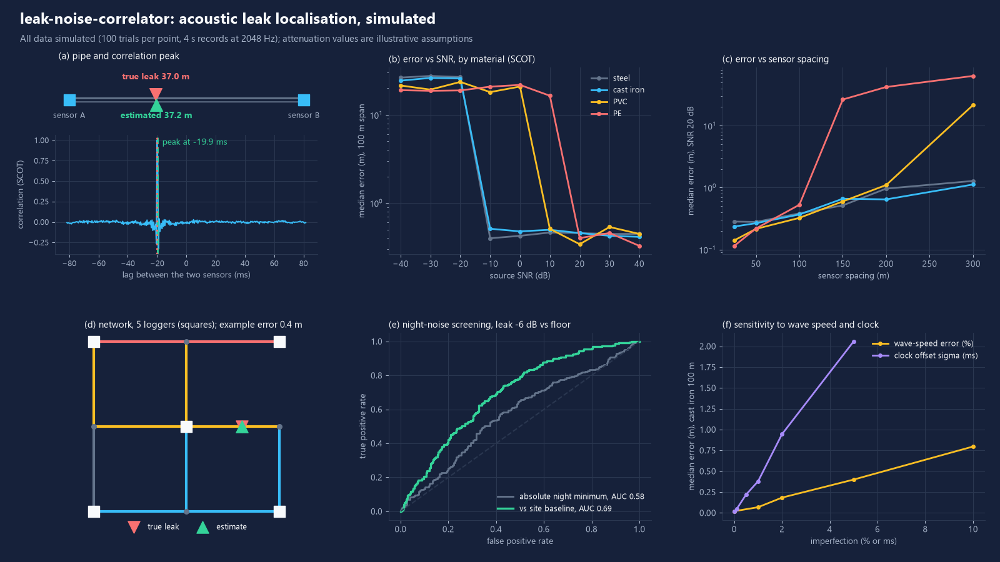
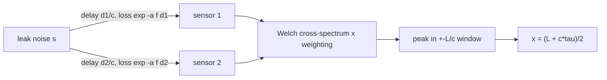

# leak-noise-correlator

Open-source acoustic leak localisation for water pipes: two sensors, one correlation peak, one position along the pipe. Physics simulation, four correlation weightings, a small pipe-network locator, night-noise screening and a compact LoRaWAN payload. Everything below is measured on simulated data.



## What it does

- **Physics simulation** of a leak noise source on a pipe between two sensors. Wave speed from material, diameter and wall thickness (Korteweg/Joukowsky formula for fluid-filled thin-walled pipes), frequency-dependent attenuation (plastic attenuates far more than metal), background noise (sensor floor, traffic bursts, 50 Hz mains/pump tones), sensor clock offset and wave-speed error.
- **Time-delay estimation**: plain cross-correlation, GCC-PHAT, SCOT and Roth weighting on a Welch-averaged cross-spectrum; peak picking inside the physically possible lag window with parabolic refinement; confidence from peak-to-sidelobe ratio.
- **Network**: loggers on a 9-node, 11-pipe simulated district with mixed materials. Pairwise correlations give time differences of arrival; a grid search over all pipes finds the leak position (truncated quadratic cost, so one bad pair does not dominate).
- **Night-noise screening**: minimum night noise level per logger, with and without a per-site baseline, scored by ROC/AUC.
- **Edge**: 10-byte LoRaWAN uplink of noise statistics, downlink command for an on-demand raw snippet, snippet upload as independently decodable 4-bit ADPCM frames, JavaScript decoder (ChirpStack v4 / The Things Stack v3 payload-formatter style).

## Results

All numbers are produced by `python -m leakcorr demo` (seeded; 100 trials per point; 4 s records at 2048 Hz; 100 m span unless stated). Unless a row says otherwise, each trial has the nominal wave speed wrong by a random +-5 % and a sensor clock offset with sigma 0.5 ms, because real wave speed is never known exactly. SNR is source-referred: leak noise power at the leak over total background power at each sensor, so distance and material loss reduce the effective SNR.

**Wave speed** (formula, typical dimensions): steel 1277 m/s, cast iron 1286 m/s, PVC 408 m/s, PE 265 m/s.

**Localisation error vs SNR and material** (SCOT; median error in m / share of fixes within 5 m):

| source SNR | steel | cast iron | PVC | PE |
|---|---|---|---|---|
| -10 dB | 0.40 / 100 % | 0.51 / 100 % | 18.1 / 19 % | 20.9 / 10 % |
| 0 dB | 0.42 / 100 % | 0.48 / 100 % | 20.9 / 24 % | 21.8 / 10 % |
| 10 dB | 0.46 / 100 % | 0.50 / 100 % | 0.51 / 100 % | 16.5 / 28 % |
| 20 dB | 0.46 / 100 % | 0.46 / 100 % | 0.34 / 100 % | 0.40 / 76 % |
| 30 dB | 0.44 / 100 % | 0.42 / 100 % | 0.53 / 100 % | 0.46 / 99 % |

The transition is sharp: with a few seconds of broadband noise the correlator either locks onto the peak (sub-metre error, dominated by the wave-speed and clock errors) or it does not (error of the order of a quarter of the span). Metal locks at about -10 dB source SNR, PVC needs about +10 dB, PE about +20 to +30 dB.

**Weighting comparison** (share of fixes within 5 m):

| case | xcorr | PHAT | SCOT | Roth |
|---|---|---|---|---|
| cast iron, -10 dB | 29 % | 100 % | 100 % | 100 % |
| PE, 20 dB | 100 % | 66 % | 76 % | 71 % |
| PE, 30 dB | 100 % | 93 % | 99 % | 74 % |

Whitening weightings help in metal (the signal is broadband, so flattening the spectrum sharpens the peak) and hurt in plastic, where there is no signal above roughly 100 Hz and whitening amplifies noise-only bins. Plain cross-correlation was best on PE here.

**Sensor spacing** (SCOT, 20 dB source SNR; median error in m / share within 5 m):

| spacing | steel | cast iron | PVC | PE |
|---|---|---|---|---|
| 50 m | 0.28 / 100 % | 0.27 / 100 % | 0.22 / 100 % | 0.22 / 100 % |
| 100 m | 0.38 / 100 % | 0.37 / 100 % | 0.32 / 100 % | 0.53 / 79 % |
| 150 m | 0.52 / 100 % | 0.66 / 100 % | 0.60 / 100 % | 26.4 / 30 % |
| 200 m | 0.96 / 100 % | 0.65 / 100 % | 1.10 / 81 % | 42.2 / 12 % |
| 300 m | 1.28 / 99 % | 1.12 / 98 % | 21.5 / 49 % | 63.5 / 8 % |

**Sensitivity** (cast iron, 100 m, 30 dB, one imperfection at a time): a clock offset with sigma 1 ms gives 0.38 m median error (about c*dt/2), 5 ms gives 2.1 m; a wave-speed error of up to +-5 % gives 0.40 m, up to +-10 % gives 0.80 m.

**Network** (9 nodes, 11 pipes, 5 loggers, SCOT, 100 random leaks, source SNR 50 dB / 30 dB): leak assigned to the correct pipe 86 % / 80 %; median error 0.31 m / 0.35 m; share of leaks within 10 m 81 % / 68 %; no usable fix in 1 / 8 trials. The tail is real: p90 error is 26 m / 69 m, mostly leaks on the long PE and PVC runs.

**Night-noise screening** (300 healthy sites, 300 sites with a new leak; 12 one-second windows per night; site floors differ by 3 dB sigma; occasional traffic events and all-night pump disturbances; 7-night learning period):

| leak vs in-band floor | AUC absolute min night level | AUC vs site baseline | TPR at 5 % FPR (abs / baseline) |
|---|---|---|---|
| -6 dB | 0.58 | 0.69 | 8 % / 12 % |
| -3 dB | 0.64 | 0.86 | 12 % / 30 % |
| 0 dB | 0.78 | 0.99 | 30 % / 94 % |
| +3 dB | 0.85 | 1.00 | 39 % / 100 % |

An absolute threshold cannot be shared across sites with different noise floors; comparing each logger with its own history works once the leak is about as loud as the floor.

**Compute**: 2.7 ms per two-sensor correlation (any weighting) for 4 s of data (8192 samples, 7 Welch segments of 2048), pure Python + numpy 2.5.4 on a 2013 dual-core laptop CPU, one thread. Analytic FFT work is about 0.84 MFLOP per pair. Not measured on a microcontroller.

**Snippet upload over LoRaWAN**: 4 s at 2048 Hz = 8192 samples = 98 ADPCM frames of 48 B (4704 B, 4x smaller than int16). ADPCM reconstruction SNR 16.7 dB (cast iron) and 23.7 dB (PVC) on the simulated recordings; localisation error unchanged (median 0.016 m raw vs 0.016 m ADPCM for cast iron, 0.009 m vs 0.008 m for PVC; no wave-speed error in this test). EU868, 125 kHz, formula airtime: SF7 0.113 s per frame, 11.1 s total, 18.4 min wall clock under a 1 % duty cycle; SF9 36.2 s total, 60 min. Snippets are for on-demand confirmation, not routine reporting.

## Quick start

```bash
python -m venv .venv && .venv/bin/pip install -r requirements-dev.txt   # Windows: .venv\Scripts\...
python -m leakcorr locate --material pe --length 80 --leak 30 --snr 25   # one simulated leak
python -m leakcorr demo --quick      # about 1-2 min, few trials, writes docs/ and results/
python -m leakcorr demo              # full run (about 10 min on 4 cores): reproduces the tables above
python -m pytest -q && node js/test.js
```

`demo` writes `results/results.json` (all numbers), `docs/figure.png`, `docs/post-figure.png` and `docs/linkedin.json`. `python -m leakcorr figures` redraws from a saved `results.json`.

## How it works



- Wave speed: `c = sqrt((K/rho) / (1 + K*D/(E*e)))` with K water bulk modulus, rho density, D diameter, E wall Young's modulus, e wall thickness (Wylie, Streeter & Suo, *Fluid Transients in Systems*, Prentice Hall 1993; Korteweg 1878, Ann. Phys. 241(12), 525-542). Leak-noise behaviour in plastic pipes: Gao, Brennan, Joseph, Muggleton & Hunaidi, J. Sound Vib. 277(1-2), 133-148 (2004); Hunaidi & Chu, Applied Acoustics 58(3), 235-254 (1999).
- Time delay: generalised cross-correlation (Knapp & Carter, IEEE TASSP 1976), SCOT (Carter et al. 1973), Roth (1971).
- Lag convention: `tau = t1 - t2`; the leak is `(L + c*tau)/2` from sensor 1. A clock offset `dt` shifts the position by `c*dt/2`; a wave-speed error shifts it in proportion to how far the leak is from the midpoint.
- Night screening: windows between 02:00 and 04:00, minimum in-band (100-800 Hz) level; the minimum rejects sporadic traffic, a leak raises the floor all night.
- Payload (port 1, 10 bytes): header (version, leak-suspect, snippet-ready, low-battery, 3-bit counter), min/mean/max level (0.5 dB steps, dB re full scale), spread (0.1 dB), dominant frequency (8 Hz steps), battery (10 mV steps), temperature (int8), minute of the night minimum (uint16). Downlink port 2: `01 <id> <seconds>` requests a snippet. Snippet frames (port 3): `id, index, count, predictor(int16), step index, nibbles`, each frame independently decodable so a lost frame loses only its own samples. Full layout in `leakcorr/lorawan.py`; decoder and `encodeDownlink` in `js/decoder.js`, tested against golden vectors from the Python encoder.

## Data sources

None. All signals are synthetic. Material constants (Young's modulus, typical dimensions) are textbook-style round numbers; the attenuation coefficients are illustrative assumptions chosen to reproduce the qualitative ordering (steel < cast iron < PVC < PE), not measurements.

## What is not verified yet

- No real field recordings, no hydrophone/accelerometer hardware. Every accuracy number is simulation-only and flatters reality: stationary Gaussian leak noise, no dispersion, no pipe-wall modes, no reflections or branching losses at junctions, no soil loading of buried pipes, thin-wall wave-speed formula only.
- Attenuation coefficients are assumed. Real plastic-pipe attenuation depends on soil, diameter and frequency and must be measured per site.
- Sub-metre errors reflect an ideal matched model; the dominant real-world error is the wave speed, which has to be measured or calibrated in the field.
- The network locator ignores multipath and assumes the loggers are time-synchronised to about 0.5 ms.
- Night-screening data is synthetic; the nuisance model (events, pump, site spread) is my assumption.
- LoRaWAN payload and airtime are checked against the standard formula and a decoder test, not on radio hardware. Compute was timed on a laptop CPU, not on a microcontroller.
- Literature citations are given from memory of the standard references; check details before quoting.

## Licence

MIT, Copyright (c) 2026 Victor Bonilla. See `LICENSE`.
